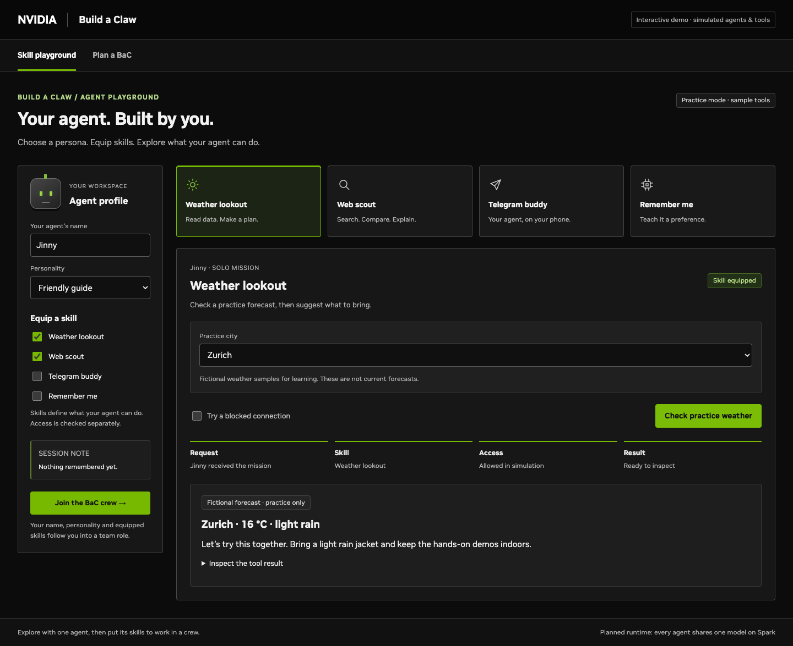

# BaC Crew

An interactive agent playground: create a persona, try individual skills, then bring that agent into a crew to plan a Build a Claw event. Switch between **A · Crew village** and **C · Progress board** to inspect the team's work.

**Current status:** working browser UI with practice weather, prepared search examples, a simulated Telegram phone, session notes, deterministic agent handoffs and access-decision examples. The village is currently a CSS illustration. Real 3D, LLM inference, live weather/search, Telegram, agent orchestration and OpenShell enforcement are not connected yet.



The interface now uses an NVIDIA-inspired dark theme: neutral panels, green primary actions, compact line icons and matching styles across both crew views. See [visual design](docs/visual-design.md).

## Repeated review on Spark

Use the new [Spark setup and update guide](docs/spark-operations.md) to manage the model and app separately. After the one-time prerequisites and Git authentication:

```bash
./bac llm setup qwen   # once: shared vLLM environment and Qwen weights
./bac llm start qwen   # background model server (optional while reviewing this UI)
./bac llm check        # confirm readiness after warmup
./bac app start       # background app on port 8080
```

For each later code review, run `./bac update` and refresh the browser. This updates only the app; model files and the running LLM stay in place. `./bac rollback` restores the previous application release. To try Gemma, run `./bac llm setup gemma` once, then `./bac llm start gemma`. To delete only one model, use `./bac llm remove qwen --yes` or `./bac llm remove gemma --yes`.

These commands prepare the model endpoint independently; they do not turn the current simulated UI into live agents. The serving profiles follow the supplied HackMD setup, but actual GPU setup still needs a first verification on Spark.

## Run on DGX Spark

Requires Git, Python 3.8+ and a current Chrome, Edge or Firefox browser. No pip packages, Node.js, GPU drivers or model downloads are needed for this prototype.

```bash
git clone https://github.com/bacdemokr/tmp.git
cd tmp
./start.sh
```

Open **http://localhost:8080** in a browser on Spark. For a private repository, authenticate Git on Spark before cloning, or download the repository ZIP while signed into GitHub.

If you use Spark remotely, keep the server running and create a tunnel from your laptop:

```bash
ssh -N -L 8080:127.0.0.1:8080 YOUR_SPARK_USER@YOUR_SPARK_HOST
```

Then open **http://localhost:8080** on your laptop. To make the UI available directly on a trusted local network instead:

```bash
./start.sh --host 0.0.0.0 --port 8080
```

Open `http://SPARK_IP:8080`. This development server has no authentication. Stop it with Ctrl+C. Use `--port 8081` if port 8080 is occupied. The generated `app/index.html` also works directly as a local file.

## Try the demo

Start in **Skill playground**. Give your agent a name and personality, then choose a mission:

| Mission | What works in this preview |
|---|---|
| Weather lookout | Inspect fictional city weather and a prepared recommendation; remove the skill or block the connection to see why execution stops. |
| Web scout | Compare three prepared example results and open their evidence cards. These are not live search results. |
| Telegram buddy | Equip the skill, pair a practice phone, preview a reply, then simulate allowing or denying delivery. No Telegram message is sent. |
| Remember me | Save a preference in browser memory and see it reused by the other practice missions; forgetting or refreshing clears it. |

**Join the BaC crew** carries the name, personality and equipped skills into role onboarding. You can also switch straight to **Plan a BaC**:

1. Keep **Europe (EMEA) / Zurich / English**, or change the event brief. Defaults are 120 attendees, 180 minutes, groups of 5 and 15-minute sessions.
2. Submit the brief and advance the handoffs. Each attendee is assigned to one interest-based topic.
3. Compare A and C. Both show the same crew and shared brief version.
4. Operations detects a device shortage. Extend the event to **210 minutes** or mark additional devices as pending.
5. Inspect demo runbooks, equipment/staffing calculations, invitation copy, promotional copy and the consistency review.
6. Approve or deny the simulated policy request. Neither option sends a message or performs an external action.
7. Select **Build your agent**, choose a name, role, persona and skills, try a solo task, then join the crew. This replaces the existing agent in the selected role.

Return to **Skill playground → Telegram buddy → How is our BaC plan coming along?** to see the current shared brief in a phone-reply preview. Extending the event to 210 minutes also updates that reply.

The interface is English. Generated template examples support English, Korean and Japanese. Inputs stay in browser memory; refreshing resets the demo. Venue details, event dates and registration links remain placeholders.

## Equipment planning

The default topic split is 50% / 30% / 20%. These are editable planning assumptions, not measured GPU throughput or official hardware sizing guidance.

| Default brief | Spark stations | Workstations | Staff |
|---|---:|---:|---:|
| 120 attendees, 180 minutes | 3 | 1 | 8 |
| Same brief, extended to 210 minutes | 2 | 1 | 7 |

Staff includes one presenter per station, one floor assistant per 40 attendees (rounded up), and one event lead. Open **Calculations and assumptions** for the formulas. The hardware counts describe equipment at the planned event; they are independent of the single Spark hosting this demo.

## Project files

- `src/bac-planner.html`: editable UI, styles, planning rules and simulated workflow.
- `src/playground.html`, `src/playground.css`, `src/playground.js`: skill missions and the agent passport.
- `src/nvidia-theme.css`: the shared NVIDIA-inspired visual theme.
- `scripts/build.py`: creates a standalone page without CDN or Codex dependencies.
- `app/index.html`: generated runnable page; committed for convenient preview.
- `start.sh` / `scripts/serve.py`: local server using only Python's standard library.
- `bac`, `scripts/ops_*.py`, `runtime/profiles.json`: independent model lifecycle, app deployment and rollback.
- `docs/architecture.md`: current behavior and the intended live integration.
- `docs/skill-experiences.md`: attendee journey, reference implementations and live integration plan.
- `tests/smoke.cjs`, `tests/playground.cjs`: optional browser smoke tests.

After editing `src/bac-planner.html`, run `python3 scripts/build.py` or restart `./start.sh`, then refresh the browser.

## Optional browser validation

The application does not need these dependencies. Install them only to run the smoke test:

```bash
npm install --no-save --package-lock=false playwright
npx playwright install chromium
node tests/smoke.cjs
node tests/playground.cjs
```

On Linux, Playwright may also require OS browser libraries (`npx playwright install-deps chromium`). Alternatively set `CHROME_PATH` to an existing Chrome/Chromium executable.

The prototype was validated on macOS Chromium, including the full workflow, four skill missions, both policy choices, invalidation of outdated approvals, onboarding, shared brief updates and small-screen layouts. DGX Spark hardware execution has not yet been verified.

Host-only management tests (no model downloads or systemd changes):

```bash
python3 -m unittest discover -s tests -p 'test_management.py' -v
```
