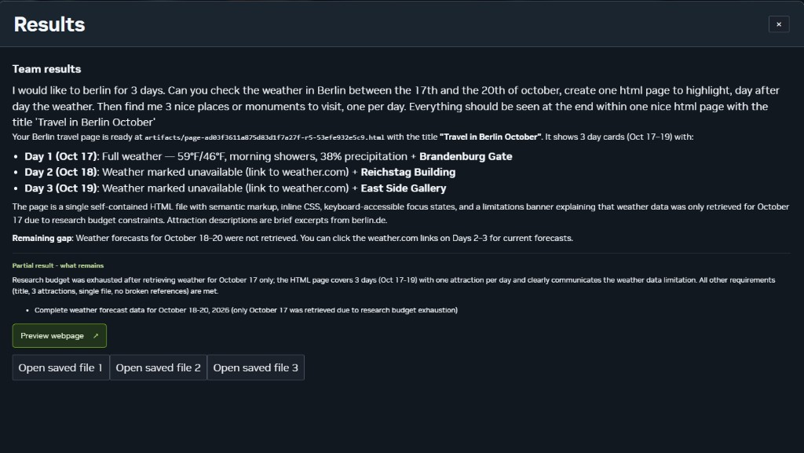
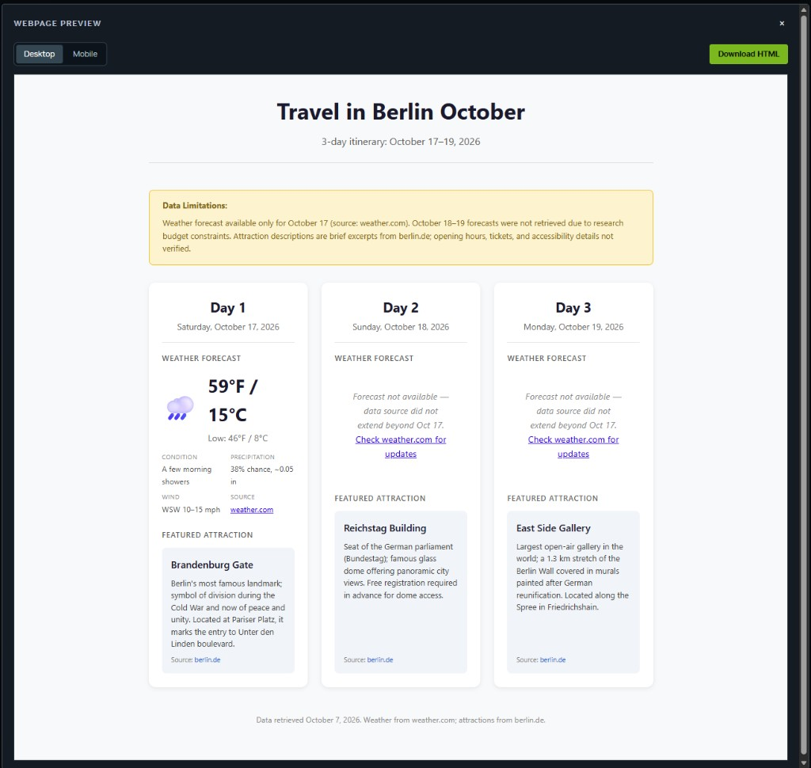
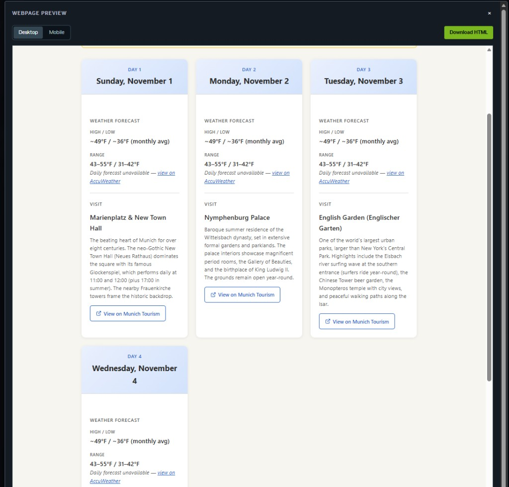
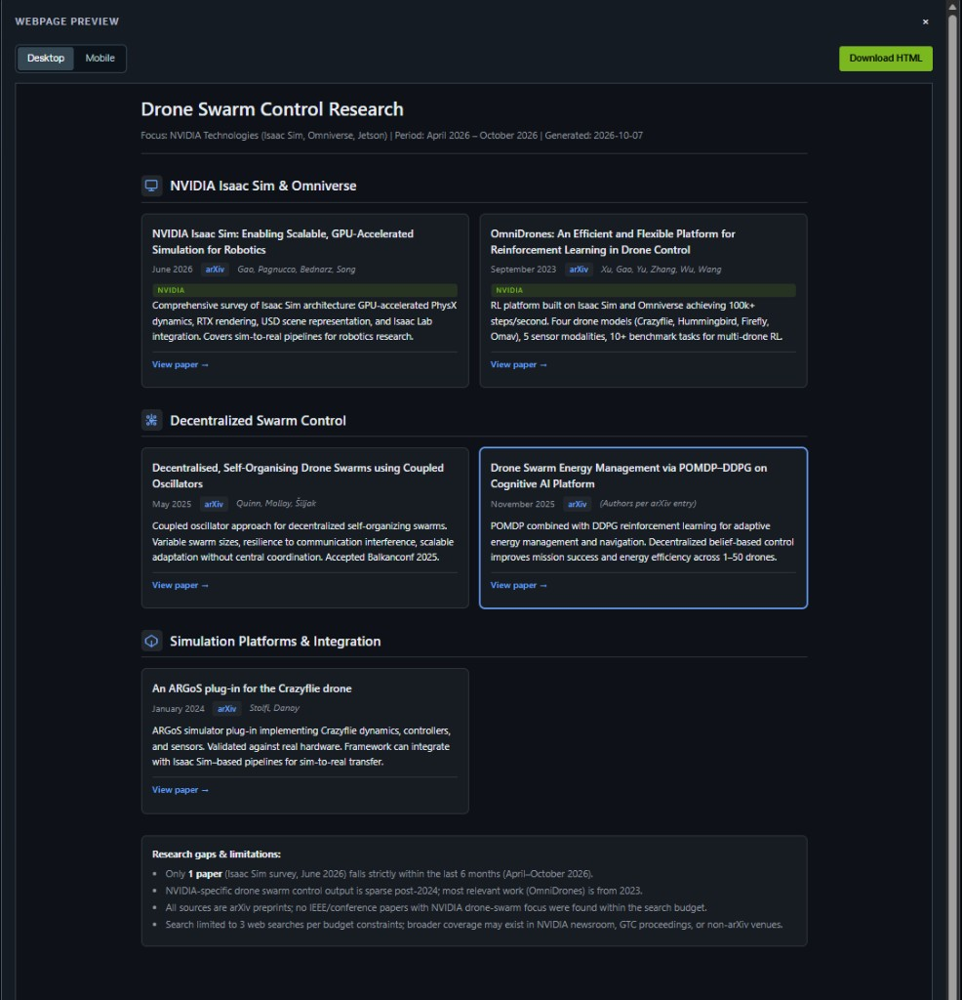
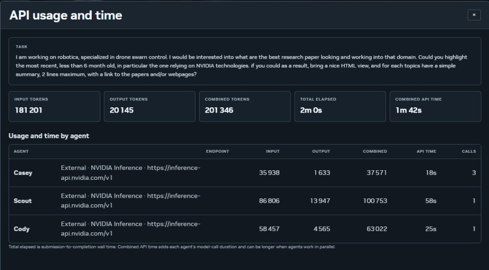
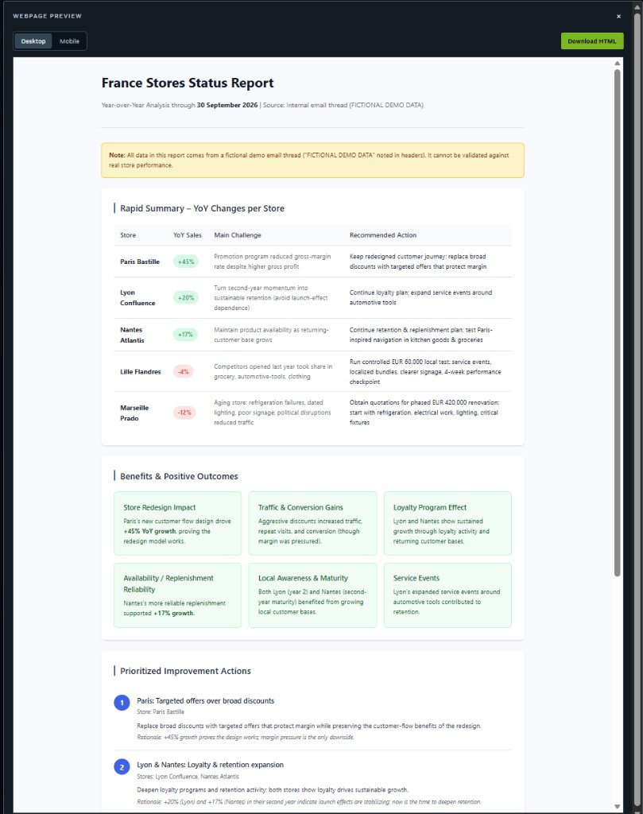
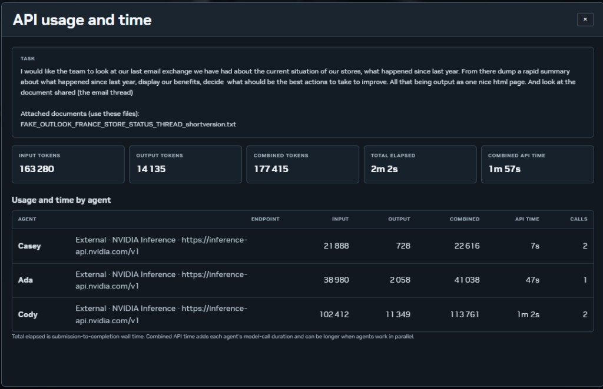
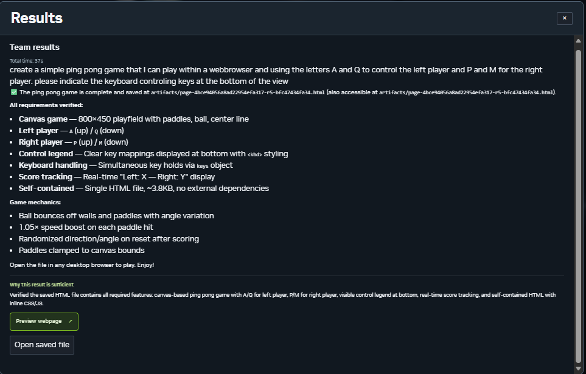
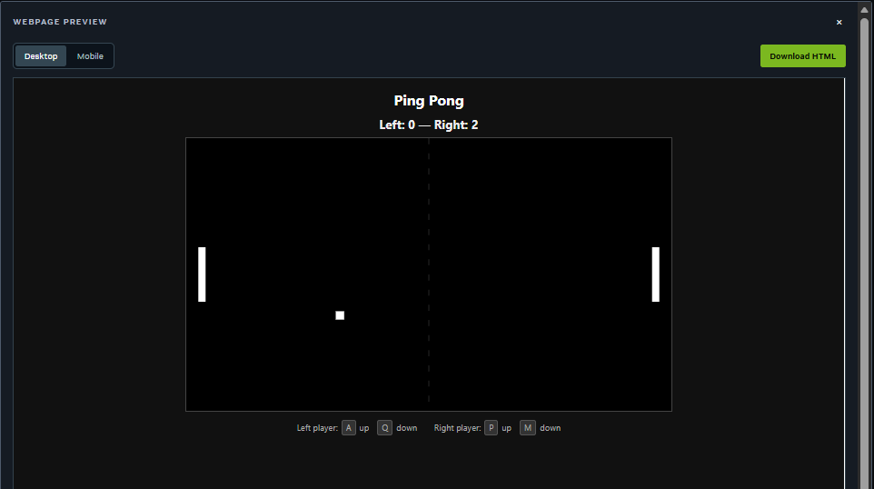

# POSSIBLE SCENARIOS
October 8, 2026

These are example requests for **3-2 Open Task**, not additional rooms or new execution modes. Screenshots and timings below are Benjamin's observed NVIDIA Inference API runs. They have not been benchmarked on local Qwen here; endpoint load and task size change the timing.

| Example | Audience | Internet needed for task tools? |
| --- | --- | --- |
| Travel | Personal planning | Yes: live weather and attractions |
| Drone research | Technical audience | Yes: source research |
| Store email review | Managers and business teams | No, when using only the supplied email |
| Ping-pong | Coding / general audience | No, for a self-contained game |

For offline use, the model must also run locally and be prepared before the demo. Select **Local** under **Settings → Model → Models → Open Task**. Event Brief has a separate connection selector. Rehearse the exact prompt and inspect the generated result; the recorded API timings below are not local-model benchmarks.

Send these prompts to **Casey in 3-2 Open Task** with `/goal`. Attach the sample email to that conversation before the business example. Open **Usage & time** after a run to compare tokens and elapsed time. The traces below record earlier runs; current team selection and recovery decisions may differ.

## Table of contents

- [Travel plan: anyone's use case](#travel-plan--anyone-uses-case)
  - [Prompt given](#prompt-given)
  - [Team](#team)
  - [Expected type of output](#expected-type-of-output)
  - [Alternative prompt and output](#alternative-prompt-and-output)
- [Drone swarm control research: technical use case](#drone-swarm-control-research-technical-use-case)
  - [Research prompt](#research-prompt)
  - [Team involved](#team-involved)
  - [Expected output](#expected-output)
  - [Time and API usage](#time-and-api-usage)
- [Business internal review](#business-internal-review)
  - [Prompt and document](#prompt-and-document)
  - [Team](#team-1)
  - [Execution trace](#execution-trace)
  - [Business review output](#business-review-output)
  - [Business review API usage and time](#business-review-api-usage-and-time)
- [Coding rapidly a simple ping pong game](#coding-rapidly-a-simple-ping-pong-game)
  - [Prompt given](#prompt-given-1)
  - [Team](#team-2)
  - [Execution trace](#execution-trace-1)
  - [Expected type of output](#expected-type-of-output-1)

## TRAVEL PLAN : anyone use's case

### prompt given

> /goal I would like to berlin for 3 days. Can you check the weather in Berlin between the 17th and the 20th of october, create one html page to highlight, day after day the weather. Then find me 3 nice places or monuments to visit, one per day. Everything should be seen at the end within one nice html page with the title 'Travel in Berlin October'

### Team

- Scout = web research.
- Cody = builds one HTML page.
- Vera = reviews the result.

| Step | Phase | Participant | Status | Details |
|---:|---|---|---|---|
| 00 | User request | **User** | Submitted | **Request:** I would like to berlin for 3 days. Can you check the weather in Berlin between the 17th and the 20th of october, create one html page to highlight, day after day the weather. Then find me 3 nice places or monuments to visit, one per day. Everything should be seen at the end within one nice html page with the title 'Travel in Berlin October'. |
| 01 | Plan | **Casey** | Plan ready | **Approach:** Weather forecast for Berlin from October 17-20, 2026, plus three attractions. Scout researches both through public sources-Open-Meteo for weather and Berlin tourism sites for attractions. Cody builds one HTML page containing daily weather cards and attraction highlights. Vera reviews the result for completeness and accuracy. |
| 02 | Contribution | **Scout** | Delivered | **Casey’s assignment:** Research Berlin weather for October 17-20, 2026 through the Open-Meteo API, then find three notable Berlin attractions or monuments, one for each day. Save the findings to `artifacts/research-brief.md` with citations.  **Expected result:** A Markdown brief containing daily temperature, conditions, and precipitation; source URL and retrieval date; three attractions with descriptions and source URLs; and any limitations.  **Received:** Casey’s brief.  **Result:** Scout’s contribution was delivered. |
| 03 | Review | **Casey** | More work needed | **After Scout’s result:** The research brief contains sufficient data for October 17 and three attractions. Cody can build the page with the available information while clearly noting that weather for October 18-19 is unavailable. |
| 04 | Contribution | **Cody** | Delivered | **Casey’s assignment:** Build one self-contained HTML page titled **Travel in Berlin October**, with daily cards for October 17, 18, and 19 and one featured attraction per day. Use the research brief. Provide a clean desktop layout, semantic HTML, basic CSS, and keyboard accessibility.  **Expected result:** A dependency-free page at `artifacts/travel-berlin-october.html`, showing three daily cards with weather and attraction information consistent with the research brief.  **Received:** Casey’s brief and Scout’s contribution.  **Result:** Cody’s contribution was delivered. |
| 05 | Review | **Casey** | More work needed | **After Cody’s result:** The page contains the available weather for October 17 and all three attractions. Vera should verify the exact title, three-day coverage, weather for each day, one attraction per day, and the single-file requirement. The original request mentions October 17-20, which spans four calendar dates, while the requested trip and available page cover three days; the review must identify this gap. |
| 06 | Contribution | **Vera** | Delivered | **Casey’s assignment:** Review the HTML page against the requirements: exact title, October 17-19 coverage, weather for every day, three attractions with one per day, one self-contained file, and no broken references.  **Expected result:** A review report with a pass or fail for each requirement and a description of every issue.  **Received:** Casey’s brief, Scout’s contribution, and Cody’s contribution.  **Result:** Vera’s contribution was delivered. |
| 07 | Review | **Casey** | Partial result | **After Vera’s result:** The research budget was exhausted after obtaining weather for October 17 only. The HTML page covers October 17-19, assigns one attraction to each day, and communicates the weather limitation. The title, three attractions, single-file delivery, and absence of broken references satisfy the remaining requirements.  No additional agents will be called. |
| 08 | Response | **Casey** | Partial result | Final team response. |

### expected type of output

### Alternative prompt and output

**Prompt:** `/goal I would like to berlin for 3 days. Can you check the weather in Berlin between the 17th and the 20th of october, create one html page to highlight, day after day the weather. Then find me 3 nice places or monuments to visit, one per day. Everything should be seen at the end within one nice html page with the title 'Travel in Berlin October'`

## DRONE SWARM CONTROL RESEARCH: technical use case

### Research prompt

> /goal I am working on robotics, specialized in drone swarm control. I would be interested into what are the best research paper looking and working into that domain. Could you highlight the most recent, less than 6 month old, in particular the one relying on NVIDIA technologies. if you could as a result, bring a nice HTML view, and for each topics have a simple summary, 2 lines maximum, with a link to the papers and/or webpages?

### Team involved

- **Scout:** Researches recent drone-swarm-control papers, with particular attention to work that uses NVIDIA technologies.
- **Cody:** Turns Scout's research into a polished, self-contained HTML page.

Casey coordinates the workflow, assigns the research and implementation tasks, and combines the agents' contributions.

### Expected output

A self-contained HTML research dashboard that groups the selected papers by topic, provides a concise summary for each paper, and includes links to the papers or supporting webpages.

### Time and API usage

The run completed in approximately two minutes. The recorded combined agent time was 1 minute 42 seconds:

- **Input tokens:** 181,201
- **Output tokens:** 20,145
- **Combined tokens:** 201,346

## Business internal review

### Prompt and document

> /goal I would like the team to look at our last email exchange we have had about the current situation of our stores, what happened since last year. From there dump a rapid summary about what happened since last year, display our benefits, decide what should be the best actions to take to improve. All that being output as one nice html page. And look at the document shared (the email thread)

**Attached document:** [`FAKE_OUTLOOK_FRANCE_STORE_STATUS_THREAD_shortversion.txt`](scenario/FAKE_OUTLOOK_FRANCE_STORE_STATUS_THREAD_shortversion.txt)

### Team

- **Ada:** Analyzes the year-over-year results, benefits, challenges, and recommended actions.
- **Cody:** Builds a single HTML page containing the summary.

Casey coordinates the work and passes Ada's structured analysis to Cody.

### Execution trace

| Step | Phase | Participant | Status | Details |
|---:|---|---|---|---|
| 00 | User request | **User** | Submitted | **Request:** Review the supplied email thread about the current situation of the five stores. Summarize what changed since last year, highlight the benefits, decide which actions should be taken, and present everything in one polished HTML page.  **Attached document:** `FAKE_OUTLOOK_FRANCE_STORE_STATUS_THREAD_shortversion.txt`. |
| 01 | Plan | **Casey** | Plan ready | **Approach:** Read the email thread first and extract the store-performance data. Assign Ada to analyze the year-over-year results and benefits, then assign Cody to build a single HTML page containing the summary, benefits, and recommended actions. No external research is required because all data is in the supplied document. |
| 02 | Contribution | **Ada** | Delivered | **Casey's assignment:** Read the full email thread and extract each store's year-over-year sales result, main challenge or explanation, and recommended action. Identify overall benefits-such as the impact of store redesign, traffic, and conversion gains-and synthesize recommended actions across the stores.  **Expected result:** A concise analysis saved to `artifacts/store-analysis.md`, including a store-by-store table with the name, year-over-year percentage, challenge, and action; a benefits summary; and prioritized improvement actions with rationale.  **Received:** Casey's brief.  **Result:** Ada delivered the analysis. |
| 03 | Review | **Casey** | More work needed | **After Ada's result:** The analysis contains store-by-store year-over-year data, a benefits summary, and prioritized actions. Cody should now build the self-contained HTML page using this analysis. |
| 04 | Contribution | **Cody** | Delivered after retry | **Casey's assignment:** Build one self-contained, desktop-friendly HTML page presenting: 1) a rapid summary of what changed since last year, including the year-over-year result for each store; 2) the benefits and positive outcomes; and 3) prioritized actions for improvement. Use Ada's analysis and provide a clean, accessible layout with clear sections.  **Expected result:** A working file at `artifacts/store-status-report.html`, with no external dependencies and inline CSS or JavaScript only.  **Received:** Casey's brief and Ada's contribution.  **Result:** Cody's first handoff was incomplete. A subsequent call completed the self-contained HTML report. |
| 05 | Response | **Casey** | Delivered | **Final team response:** The store analysis and completed HTML report were returned to the user. |

### Business review output

The final result is a self-contained **France Stores Status Report** containing:

- A rapid year-over-year summary for all five stores
- The main challenge and recommended action for each store
- Benefits and positive outcomes
- Prioritized improvement actions with supporting rationale

### Business review API usage and time

The run completed in **2 minutes 2 seconds**, with **1 minute 57 seconds** of combined agent time:

- **Input tokens:** 163,280
- **Output tokens:** 14,135
- **Combined tokens:** 177,415
- **Model endpoint:** NVIDIA Inference API
- **Agents called:** Casey, Ada, and Cody

| Agent | Input | Output | Combined | Agent time | Turns |
|---|---:|---:|---:|---:|---:|
| Casey | 21,888 | 728 | 22,616 | 7s | 2 |
| Ada | 38,980 | 2,058 | 41,038 | 47s | 1 |
| Cody | 102,412 | 11,349 | 113,761 | 1m 2s | 2 |

## Coding rapidly a simple ping pong game

### Prompt given

> /goal create a simple ping pong game that I can play within a webbrowser and using the letters A and Q to control the left player and P and M for the right player. please indicate the keyboard controling keys at the bottom of the view

### Team

- **Cody:** Programs the simple browser-based game.

Casey coordinates the workflow, assigns the implementation to Cody, and verifies the result.

### Execution trace

| Step | Phase | Participant | Status | Details |
|---:|---|---|---|---|
| 00 | User request | **User** | Submitted | **Request:** Create a simple ping pong game that can be played in a web browser. Use A and Q to control the left player and P and M to control the right player. Show the keyboard controls at the bottom of the view. |
| 01 | Plan | **Casey** | Plan ready | **Approach:** This simple ping pong game requires only Cody. Cody will implement the browser-based game with the specified keyboard controls-A/Q for the left player and P/M for the right player-and a control legend at the bottom. |
| 02 | Contribution | **Cody** | Delivered | **Casey's assignment:** Create a self-contained HTML file containing a Canvas-based ping pong game. Implement two paddles controlled by A/Q on the left and P/M on the right, a bouncing ball, score tracking, and a control legend at the bottom showing the keyboard mappings. Keep it desktop-focused, keyboard accessible, and approximately 6,000 characters or fewer.  **Expected result:** A working `index.html` file in `artifacts/`, with complete game logic, keyboard handling, Canvas rendering, and visible control instructions at the bottom. No external dependencies.  **Received:** Casey's brief.  **Result:** Cody delivered the game. |
| 03 | Revision request | **Casey** | One targeted revision | **Why repair is needed:** Verify that the saved implementation meets every requirement before finalizing it. Confirm that the file is saved at the correct path and implements A/Q controls for the left player, P/M controls for the right player, a control legend at the bottom, keyboard handling, and score tracking. |
| 04 | Revision | **Cody** | Revised result delivered | **Casey's revision assignment:** Read the saved HTML file at `inbox/plan-4bce94056a8ad22954efa317-r5-0.html` and verify that the implementation is complete.  **Expected result:** Confirmation that the file contains the Canvas game, correct key bindings, a visible control legend at the bottom, a score display, and self-contained HTML.  **Result:** Cody delivered the revised contribution. |
| 05 | Review | **Casey** | Final verification | The saved HTML file contains every required feature: a Canvas-based ping pong game, A/Q controls for the left player, P/M controls for the right player, a visible control legend at the bottom, real-time score tracking, and self-contained HTML with inline CSS and JavaScript.  No additional specialists will be called. |
| 06 | Response | **Casey** | Response ready | Final team response. |

### Expected type of output

