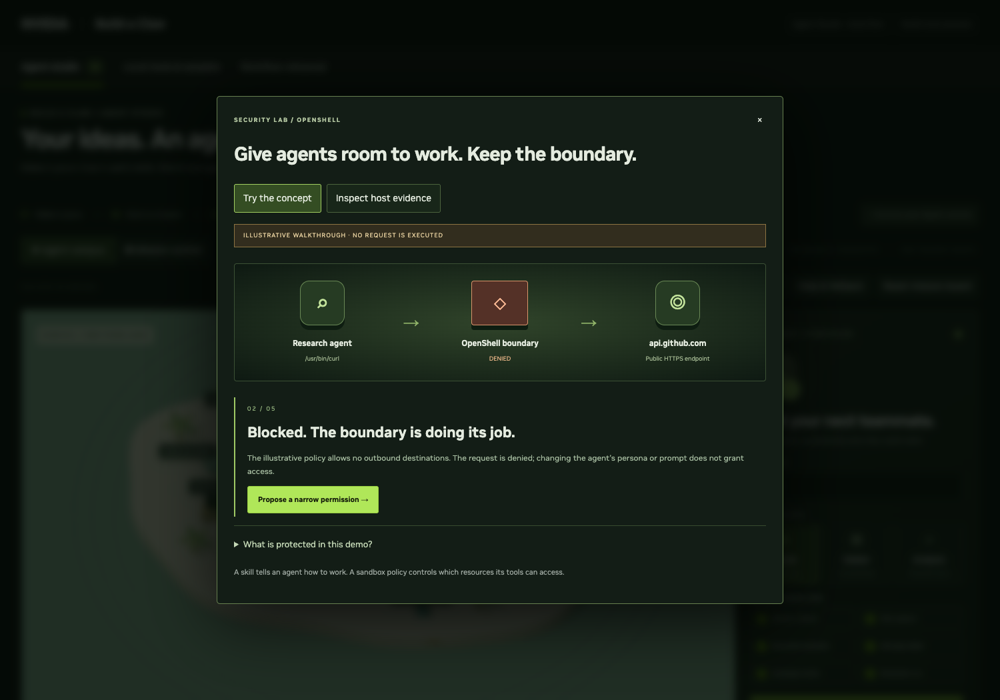

# Cohort requirements and acceptance checks

This checklist maps the four requirements in the supplied **Jinho and Korea team / New multi-agent demo** slide to this implementation. It records implemented behavior separately from host acceptance. OpenShell is required for NeMoReef in that slide; it is an optional extension here.

| Requirement | Implemented experience | Acceptance still needed |
| --- | --- | --- |
| Second working implementation for the cohort | Three 3D rooms for creation/setup, a growing personal-agent lounge and five-role collaboration, plus a dedicated per-agent Policies tab; up to 12 agents with saved appearances, editable personas/skills, real OpenClaw execution, one shared model, mission control and an editable event brief | Run the complete journey with Qwen or Gemma on the actual Spark; record timing and review output quality. Local protocol fixtures are not LLM acceptance. |
| Agent roles, handoffs, shared state and visible evidence | Five distinct native agent identities/workspaces, with custom agents assignable to specialist roles. Inspect shared state shows each role’s actual brief, received prior outputs, timestamps, input/output hashes and saved deliverables. Owner-scoped evidence export. | Inspect the produced event plan and reviewer’s findings on the chosen model. The hash is an app fingerprint, not cryptographic attestation. |
| Safe attendee controls, reset, fallback and escalation | Queued/waiting cancel; running stop at a model-call boundary; reset only the selected agent’s mission board; recovery with explicit retry; local-tool and labeled-rehearsal fallbacks; evidence download for the facilitator | Rehearse stop during inference, runtime loss and app restart on Spark. A current call can still write files before stopping. Never claim instant GPU cancellation. |
| NeMoReef comparison and attendee routing | Facilitator guidance in the presenter runbook compares the Studio’s onboarding/skills/crew focus with the supplied Reef brief. | Facilitator confirms the event’s available demos and station or launch URL. No attendee-facing routing control is provided. |

## What changed after this review

The Studio provides reset, stop after the active model call, recovery, shared-input inspection and the OpenShell Security lab within the existing dark NVIDIA-inspired layout. Cross-demo comparison and routing guidance live in the presenter runbook.

## Reset and failure semantics

- Reset cancels pending/scheduled work and archives this owner’s visible board. It preserves identity, memory, files and archived evidence; it does not erase personal data. Use a new browser profile for a different attendee.
- Reset returns a conflict while a call is running or stopping. It does not claim to cancel gateway execution: after a timeout or app restart, the remote request may still be finishing. The host must check it before retrying; board reset only archives app state.
- Stop requests are durable. The current call may finish and save files; the next role and a channel reply do not start after the stop is observed. A host crash marks running/stopping work as interrupted, not silently cancelled or replayed.
- Retry is a separate, explicit mission from the beginning, with prior evidence retained. Review files first because the active call may already have produced useful work.
- Escalation is a participant-downloaded evidence package to review and share with the facilitator. The app does not automatically send task content to anyone.

## OpenShell: the visible security story

For a live personal-agent exercise, open **Policies**: select an owned agent, choose OpenShell on/off, inspect approved destinations, approve/revoke curated public reads and compare actual access logs with approval history. Protected internet requests use sandboxed curl; the preset multi-agent crew is outside OpenShell. Follow the [host acceptance sequence](live-studio.md#openshell).

The separate concept/evidence lab is available through **Access gate** in the 3D world or **Security lab** above it.

1. **Try the concept** is an explicitly illustrative walkthrough. Attempt a public read, see default denial, propose a narrow operator permission, retry, and discover that another destination remains denied. No command or policy change is executed by these learner buttons.
2. **Inspect host evidence** displays only a report collected by the operator test. With no report, it says **NO COMPLETE HOST PROOF**. Each step requires both the expected request outcome and a matching policy log for the exact host and `/usr/bin/curl`.
3. On a host with OpenShell installed and its gateway running, run `./bac openshell prove`. It creates a uniquely named **separate** sandbox with no automatic provider credentials. It attempts fixed public GET requests, applies a read-only allowlist for `api.github.com:443`, retries, and verifies `example.com` remains denied. No POST, user document, secret or attendee prompt is sent. It removes only its own temporary sandbox and records cleanup status.
4. Raw command/log capture stays under `studio/security-captures/bac-proof-*/` in the private data directory. The UI receives outcomes, sanitized matched log fields and hashes, CLI version, sandbox name and capture time, not credentials or SSH configuration. A capture is a past operator observation, not a signed attestation of current global policy.

The probe follows the official [OpenShell policy example at a pinned commit](https://github.com/NVIDIA/OpenShell/tree/fa0bfa490e42c87a74a70be6ebb40faee7fb8faa/examples/sandbox-policy-quickstart). CLI/schema mismatch, missing logs, DNS failure, upstream HTTP failure or timeout produces an incomplete result. The test does not infer a policy denial from a failed request alone. The read-only policy is configured, but this probe does not test write-method denial or filesystem restrictions.

### Boundaries that must remain explicit

- The proof sandbox is separate from native OpenClaw agent sandboxes. A successful probe does **not** establish that all attendee traffic is sandboxed.
- The configured OpenClaw plugin routes protected native filesystem and exec operations through OpenShell. Protected agents disable host-side `web_fetch`/`web_search`; standard agents retain their usual tools. The shared LLM and BaC Telegram adapter remain on the host, outside the sandbox network policy.
- Equipment planning approval, stop/reset and session/file-access guards are application controls. Generated-HTML isolation is a browser control. Neither is an OpenShell enforcement event.
- To inspect the real agent sandbox after a mission, run `./bac openshell check` and use the host’s OpenShell sandbox/policy logs. The Policies UI can change only the participant’s own idle personal agents and predefined public-read permissions; host/global policies remain under operator control.

## Presenter fault checks

1. Queue a follow-up, cancel it, refresh and verify it cannot run later.
2. Stop during the first crew model call. Verify the UI says stopping until that call returns; its output may remain, but Nova must not start.
3. Try reset during that call. Verify it fails visibly and leaves the current board intact. After stop finishes, reset and verify the agent, memory and files remain; a second participant stays unchanged.
4. Stop the test runtime between missions. Show the actual failure, download evidence, select an explicitly labeled fallback, then deliberately retry after recovery.
5. Inspect the five input handoffs and Pico’s output. Ask a participant to explain why Momo needs the demo and operations outputs.
6. Open Security lab with no capture: verify there is no green enforcement-success claim. Run the host proof; inspect the three request/log pairs and cleanup status.
7. Route a participant to the event’s NeMoReef station for persistent work and deeper policy/failure recovery.

The new lifecycle, owner isolation and proof-classifier tests run without a GPU. Browser tests use an explicit model fixture. Real Spark inference and actual OpenShell enforcement remain host acceptance tasks until run there.
