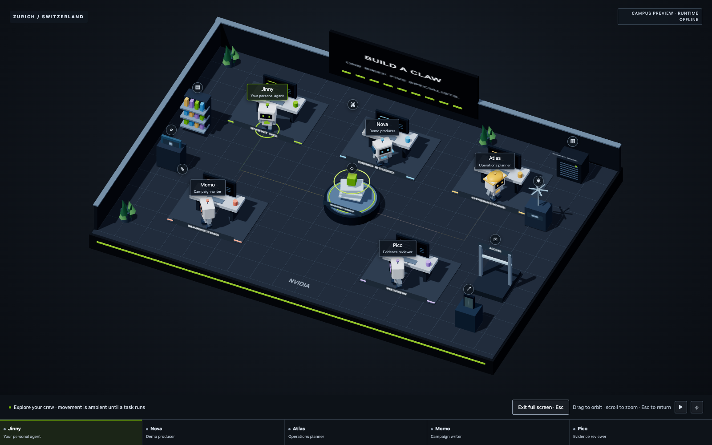

# NVIDIA-inspired demo styling

This prototype uses a local theme informed by the public [NVIDIA Build interface](https://build.nvidia.com/), inspected on September 19, 2026. It is a custom theme, not an installation of the Kaizen component library.

## Applied choices

- A near-black canvas with distinct neutral-gray panels and input surfaces.
- NVIDIA green (`#76b900`) on primary actions, selected tabs, active missions and completed execution steps.
- White headings, readable gray supporting text and amber for blocked requests or pending decisions.
- Small, consistent corner radii, thin borders and simple line icons.
- A shared treatment across the skill playground, agent onboarding, Agent campus, Mission control and artifacts.
- White and silver 3D robots with dark visors and distinct role accents; graphite profile icons with green eyes preserve the approachable identities.
- A fixed dark appearance so the demo is consistent across host OS themes.

The font stack uses locally available NVIDIA Sans, then Arial, Helvetica and a generic sans-serif. No font files, icon libraries or remote styling dependencies are required. The header currently renders the NVIDIA name as text.

## Editing

`src/nvidia-theme.css` contains the shared theme. It is embedded after the layout styles by `scripts/build.py`, keeping the standalone preview offline. The simple skill icons are inline SVG in `src/playground.js`.

After making a change, run `python3 scripts/build.py`. Inspect Agent campus and Mission control, onboarding and the playground at desktop and mobile widths. Color alone should not convey a task's state; retain the existing status labels and access explanations.

The main experience uses a bundled Three.js workshop with a rectangular exhibition floor, five individual workbenches, small robot specialists and a central shared-brief hub. The existing carbon-and-green panels remain. Role colors, restrained desk lighting and moving document packets make responsibilities and handoffs visible. Idle movement is ambient; active lighting and transfers follow app-observed task states. The skill buttons connect the furniture to the actual Studio experiences. The renderer runs locally in the browser and requires no CDN.

## Crew views

Agent campus emphasizes agent identity and Mission control emphasizes task status. They use the same theme and shared run state.

The same underlying job state also drives Mission control. See the [runtime guide](live-studio.md) for the live execution contract.

## Charcoal palette and neutral lighting

The workshop geometry, camera, controls and panel layout are unchanged. The olive cast was removed from both scene materials and UI surfaces:

- UI canvas: near-black charcoal (`#0b0d11`); raised surfaces use graphite and cool neutral gray. Text uses white and readable gray rather than pale green.
- Primary actions: NVIDIA green (`#76b900`). Selection, running work and state indicators retain restrained green accents. Amber and coral remain meaningful warning/denial colors.
- Scene: neutral white key light, cooler low-intensity fill, and a dark neutral ground light replace the cream/green lighting. Reduced exposure and emissive intensity keep details from washing out.
- Materials: graphite flooring, silver worktops, white robot shells, dark visors and distinct role accessories. Green stays concentrated in the shared-brief core, edge trim and indicators.
- Signs: their canvas textures bypass scene tone mapping, keeping white lettering and small color details clear.

The scene palette lives in `src/world-scene.js`, role accents in `src/campus.js`, and Studio panels in `src/studio.css` / `src/campus.css`. Existing dark styling for local tools and workflow rehearsal remains in `src/nvidia-theme.css`.

