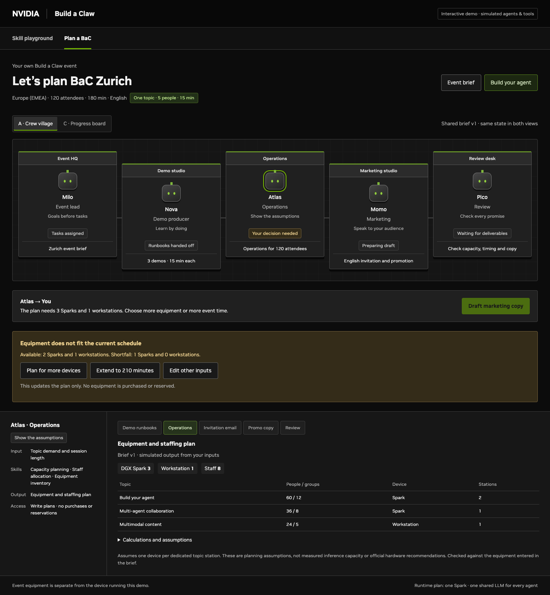
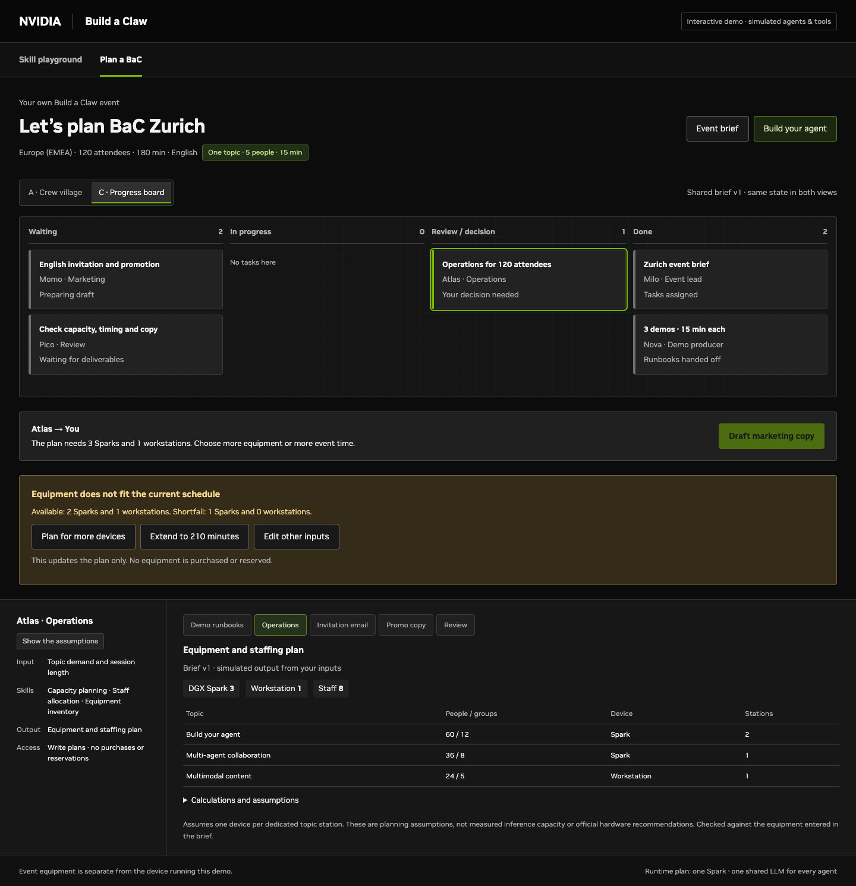

# NVIDIA-inspired demo styling

This prototype uses a local theme informed by the public [NVIDIA Build interface](https://build.nvidia.com/), inspected on September 19, 2026. It is a custom theme, not an installation of the Kaizen component library.

## Applied choices

- A near-black canvas with distinct neutral-gray panels and input surfaces.
- NVIDIA green (`#76b900`) on primary actions, selected tabs, active missions and completed execution steps.
- White headings, readable gray supporting text and amber for blocked requests or pending decisions.
- Small, consistent corner radii, thin borders and simple line icons.
- A shared treatment across the skill playground, agent onboarding, crew village, progress board and artifacts.
- Robot characters with graphite bodies and green eyes, preserving the approachable agent identities.
- A fixed dark appearance so the demo is consistent across host OS themes.

The font stack uses locally available NVIDIA Sans, then Arial, Helvetica and a generic sans-serif. No font files, icon libraries or remote styling dependencies are required. The header currently renders the NVIDIA name as text.

## Editing

`src/nvidia-theme.css` contains the shared theme. It is embedded after the layout styles by `scripts/build.py`, keeping the standalone preview offline. The simple skill icons are inline SVG in `src/playground.js`.

After making a change, run `python3 scripts/build.py`. Inspect both A/C views, onboarding and the playground at desktop and mobile widths. Color alone should not convey a task's state; retain the existing status labels and access explanations.

The visual update does not introduce model inference, live tools, OpenShell enforcement or a 3D renderer. Those remain separate integration work.

## Crew views

The village emphasizes agent identity and the progress board emphasizes task status. They use the same theme and shared run state.

